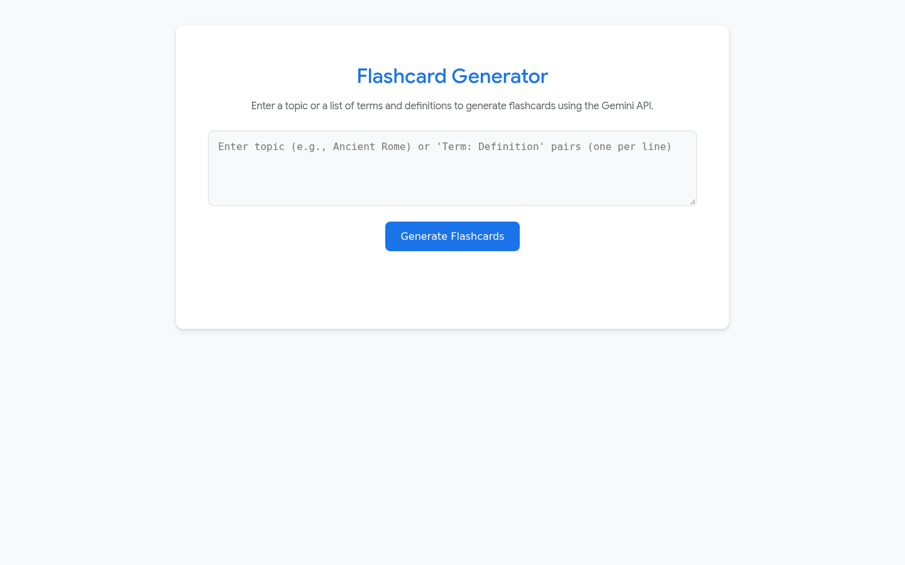
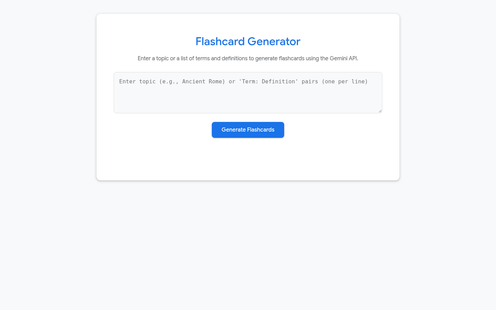

# Prompt recipe: Flashcard Maker

Topic → flashcards generator.

- **Source code:** https://github.com/google-gemini/aistudio-showcase/tree/main/src/flashcard_maker (Apache-2.0, copy in `original/`)
- **In AI Studio:** https://aistudio.google.com/apps/bundled/flashcard_maker
- **Viewport:** 1440×900, first screen, no API key (so no generated content is shown)

## Scores per round

| Round | Gemini self-score | Codex (GPT) score | Gap | SSIM | Pixel diff | Flag |
|---|---|---|---|---|---|---|
| r1 | 85 | pending | – | 0.932 | 2.1% |  |
| r2 | 92 | pending | – | 0.929 | 2.0% | model high / SSIM low |
| r3 | 95 | pending | – | 0.972 | 1.1% |  |

Final recipe = round 3 (highest Codex score, SSIM as tiebreak; falls back to the last round while Codex scores are pending).

## Screenshots

| Original | Final regeneration (r3) |
|---|---|
|  |  |

All rounds: [r1](shots/regen-r1.png) · [r2](shots/regen-r2.png) · [r3](shots/regen-r3.png)

## Final prompt

```text
Build a minimalist single-page Flashcard Generator web app powered by the Gemini API. Users enter a topic (like "Ancient Rome") or "Term: Definition" pairs (one per line) to generate interactive clickable flashcards. Keep the UI uncluttered—no navbar, sidebar, footer, sample cards, or extra controls.

Use a Google Material style loading Google Sans (400, 500) as the primary font—falling back to Roboto, Arial, and sans-serif—with normal letter spacing and automatic system light/dark mode. Use an ultra-light off-white page background (#f8f9fa). Center a white card ~40px from the top of the page, ~880px wide on desktop with ~40px side/bottom padding, ~60px top room above the heading, 12px rounded corners, and a crisp two-layer Material drop shadow clearly outlining all edges (not faint). In dark mode, use Google dark charcoal surfaces, light gray text, soft sky-blue accents (dark button text), and dark gray input and card fills.

Stack these elements in a centered column:
- A Google Blue "Flashcard Generator" heading (~32px, medium weight, not bold) with ~18px bottom spacing.
- A muted-gray subtitle (~16px, regular weight, 1.6 line height) with ~25px bottom spacing: "Enter a topic or a list of terms and definitions to generate flashcards using the Gemini API."
- A vertically resizable textarea, slightly inset (~780px wide) and ~120px tall (not taller), with ~15px padding, 8px corners, near-white fill, thin border, blue focus ring, ~25px bottom spacing, and 16px monospace text with a readable medium-gray placeholder (not faint) so "Enter topic (e.g., Ancient Rome) or 'Term: Definition' pairs (one per line)" nearly fills the width with a small right gap.
- A centered Google Blue "Generate Flashcards" button (~210x46px, ~14px by ~28px padding), 8px corners, 16px medium-weight white text, subtle shadow, hover elevation, and muted disabled state.
- Spacious white room below the button (~124px when empty), keeping a reserved-height Google Red status/error line (~20px below) and centered wrapping flashcard grid (~40px below that) always in the layout so nothing jumps.

On click, validate non-empty input; if blank, clear cards and ask for a topic or terms. Otherwise clear old cards, disable the button, show "Generating flashcards...", and ask Gemini for concise "Term: Definition" pairs (one per line). Render each pair as a 220x150px landscape card (25px gap) with pale ice-blue surface (dark gray in dark mode), thin border, and soft shadow deepening with a blue border on hover. Show the centered term on front in larger medium-weight text, flipping smoothly in 3D on click to reveal the definition in smaller muted text. Show clear errors for empty, malformed, or failed responses, and always re-enable the button.
```

## Judge notes (final round)

- **Gemini (self):** 1) The Generate Flashcards button has a noticeably darker, deeper drop shadow beneath it in B than the faint shadow in A. 2) The button label in B renders slightly tighter/heavier (narrower text width) inside a 4px narrower button. 3) The white card container has a visibly darker, crisper outer drop shadow along its bottom and side edges in B. 4) The monospace placeholder text inside the textarea sits ~2px lower (slightly more top padding) in B. 5) Minor 1-2px layout shifts: the textarea is 2px wider and 1px lower in B, while the title sits 1px higher and the subtitle 1px lower.
- **Codex (GPT):** pending

## Caveats

- **Source leak:** the reverse-engineering and refine steps read the original source code, so the prompt carries exact strings, sizes and colours a real user would rarely type. High scores show the prompt *reproduces* the app, not that a human would have *written* it.
- **First screen only:** these apps are interactive; generated content, modals and later states are not compared.
- **SSIM on flat UIs:** big plain backgrounds push SSIM up (0.9+ even for visibly different details); read it with the model notes, not alone.
- **Harness:** both original and regen are built with the same esbuild + importmap harness (`tools/shoot.sh`), which mimics AI Studio’s injected script/CSS.

Prompt history: [r1](rounds/prompt.r1.md) · [r2](rounds/prompt.r2.md) · [r3](rounds/prompt.r3.md). Generated code per round in `rounds/regen-rN/`.
