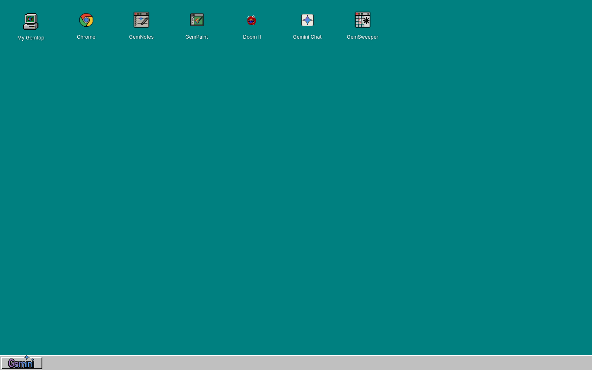
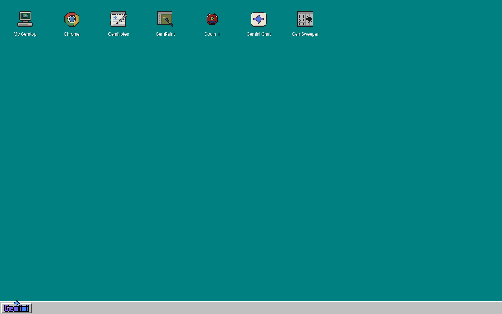

# Prompt recipe: Gemini 95

Retro Windows-95-style desktop with AI apps.

- **Source code:** https://github.com/google-gemini/aistudio-showcase/tree/main/src/gemini_95 (Apache-2.0, copy in `original/`)
- **In AI Studio:** https://aistudio.google.com/apps/bundled/gemini_95
- **Viewport:** 1440×900, first screen, no API key (so no generated content is shown)

## Scores per round

| Round | Gemini self-score | Codex (GPT) score | Gap | SSIM | Pixel diff | Flag |
|---|---|---|---|---|---|---|
| r1 | 68 | pending | – | 0.963 | 2.2% |  |
| r2 | 75 | pending | – | 0.962 | 2.2% |  |
| r3 | 86 | pending | – | 0.978 | 1.4% |  |

Final recipe = round 3 (highest Codex score, SSIM as tiebreak; falls back to the last round while Codex scores are pending).

## Screenshots

| Original | Final regeneration (r3) |
|---|---|
|  |  |

All rounds: [r1](shots/regen-r1.png) · [r2](shots/regen-r2.png) · [r3](shots/regen-r3.png)

## Final prompt

```text
Build a nostalgic Windows 95 desktop simulator called "Gemini 95" with 90s apps reimagined by Gemini AI.

Start on a full-screen classic Win95 teal desktop with no scrollbars or open windows. Near the top-left, place seven icons in one wide row spanning roughly two-thirds of the desktop width (~100px columns, ~34px gaps, ~135px center-to-center). Render all icons as muted retro pixel-art sprites with dark outlines—not bright cartoon vectors—above small white Inter labels with faint shadows.

Fix a light-gray bottom taskbar (~36px tall) with a white top edge and bare right side (no tray, clock, volume icon, or dividers). On the far left, place a beveled gray Start button with a tall, upright pixelated purple-to-blue "Gemini" wordmark (black outline) filling the button height with minimal padding, plus a black-outlined blue four-point star centered on top breaking past the top beveled edge (no flag or italics). It toggles a seven-app Start menu (navy hover); open apps show beveled buttons pressed when active.

Give windows light-gray chrome, beveled borders, navy-blue title bars with bold white titles, sunken content areas, and beveled minimize/close buttons. Use Inter for UI, Courier New for Notepad/counters, Times New Roman for browser controls, and Comic Sans for AI quips. Single-clicking icons or Start opens draggable, resizable windows that focus on click and toggle via taskbar.

Seven apps (left to right, pixel-art icons; mini-window icons use gray—not blue—title bars with tiny colored dots):
- My Gemtop (gray CRT monitor on wider desktop base, dark-green screen with colorful pixelated globe): White file explorer with C: drive revealing dontshowthistoanyone.jpg, opening an easter-egg photo in Image Viewer.
- Chrome (muted four-color Chrome wheel, dark outlines): Retro browser with URL bar and "Go!" starting on 1999 Google; any URL plays dial-up audio and connecting screen while Gemini generates a chaotic 1996 page (retro logo, neon colors, marquees, blinking text, visitor counter).
- GemNotes (muted-gray notepad window, spiral edge, lined paper, blue sparkle, gray—not yellow—diagonal pencil): Monospace notepad with "Generate Story" streaming a twist-ending Gemini story.
- GemPaint (muted-gray paint window, gray tool strip, olive-green canvas with rainbow stroke, dark diagonal brush): Canvas with swatches, eraser, S/M/L brushes, Clear, plus a bottom-right Clippy-style robot with pale-yellow speech bubble giving sarcastic Gemini vision critiques.
- Doom II (compact dark-red pixel Cacodemon, ~2/3 other icons' size, tiny white horns, one eye, dark-blue mouth): Playable Doom iframe.
- Gemini Chat (off-white/ivory—not pure white—rounded-square tile, dark border, centered blue-purple four-point star): Retro chat with streaming replies (blue user, green AI).
- GemSweeper (muted-gray window, gray grid with monochrome black digits on left, spiky black mine on right—no orange explosion): 9x9 Minesweeper with red-on-black flag/timer counters, reactive smiley reset, and "Hint" for witty Gemini commentary.
```

## Judge notes (final round)

- **Gemini (self):** 1. All 7 desktop icons are redrawn in a chunkier, thicker-outlined pixel-art style, with Gemini Chat, Chrome, and Doom II rendered noticeably larger than in the target. 2. Gemini Chat uses a larger warm cream tile with a stubbier indigo 4-point star instead of a smaller cool bluish-white tile with a slender star. 3. Doom II depicts a larger, darker maroon Cacodemon with stubby horns and a prominent dark mouth rather than the target's smaller bright-red sprite with sharper white horns. 4. My Gemtop is a flatter front-facing monitor instead of an angled 3D CRT with a globe, and GemPaint's paintbrush extends past the bottom-right frame instead of staying contained inside. 5. The bottom-left Gemini Start button uses slightly blockier lettering with the blue sparkle shifted left (over e/m rather than m/i), and GemSweeper's grid digits are chunkier and less crisp.
- **Codex (GPT):** pending

## Caveats

- **Source leak:** the reverse-engineering and refine steps read the original source code, so the prompt carries exact strings, sizes and colours a real user would rarely type. High scores show the prompt *reproduces* the app, not that a human would have *written* it.
- **First screen only:** these apps are interactive; generated content, modals and later states are not compared.
- **SSIM on flat UIs:** big plain backgrounds push SSIM up (0.9+ even for visibly different details); read it with the model notes, not alone.
- **Harness:** both original and regen are built with the same esbuild + importmap harness (`tools/shoot.sh`), which mimics AI Studio’s injected script/CSS.

Prompt history: [r1](rounds/prompt.r1.md) · [r2](rounds/prompt.r2.md) · [r3](rounds/prompt.r3.md). Generated code per round in `rounds/regen-rN/`.
