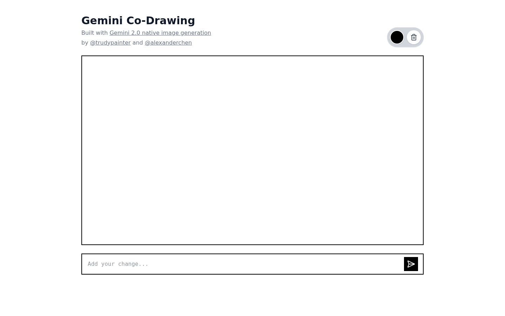
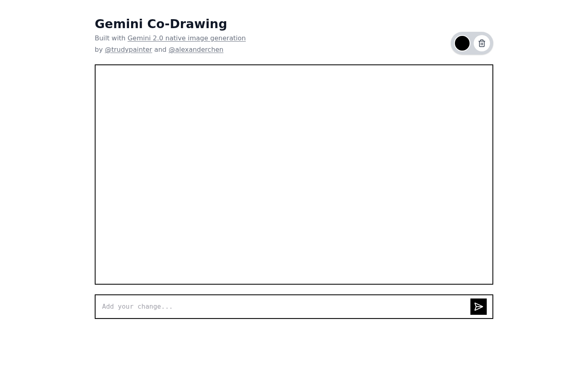

# Prompt recipe: Gemini Co-Drawing

Sketch canvas + prompt, Gemini redraws.

- **Source code:** https://github.com/google-gemini/aistudio-showcase/tree/main/src/gemini_co_drawing (Apache-2.0, copy in `original/`)
- **In AI Studio:** https://aistudio.google.com/apps/bundled/gemini_co_drawing
- **Viewport:** 1440×900, first screen, no API key (so no generated content is shown)

## Scores per round

| Round | Gemini self-score | Codex (GPT) score | Gap | SSIM | Pixel diff | Flag |
|---|---|---|---|---|---|---|
| r1 | 87 | pending | – | 0.909 | 3.2% | model high / SSIM low |
| r2 | 96 | pending | – | 0.951 | 1.8% |  |
| r3 | 98 | pending | – | 0.997 | 0.1% |  |

Final recipe = round 3 (highest Codex score, SSIM as tiebreak; falls back to the last round while Codex scores are pending).

## Screenshots

| Original | Final regeneration (r3) |
|---|---|
|  |  |

All rounds: [r1](shots/regen-r1.png) · [r2](shots/regen-r2.png) · [r3](shots/regen-r3.png)

## Final prompt

```text
Build a minimal collaborative sketching web app called "Gemini Co-Drawing" powered by Gemini 2.0 native image generation, where users draw on a canvas and prompt Gemini to edit or build on their sketch in a continuous loop.

Use a crisp light-mode design on a pure white background with default system sans-serif typography (no custom web fonts) and near-black primary text. Center a single column (~1024px max width, 24px desktop horizontal padding for clear white side margins), with 40px top padding and generous bottom breathing room.

At the top, place a header row aligned to the canvas edges with a 24px gap below, stacking on mobile. On the left, put a bold near-black title (~30px desktop, 24px mobile) with normal letter spacing (not tightened) and tight ~1.25 line height reading "Gemini Co-Drawing", followed by two regular 16px muted medium-gray subtitle lines with normal ~1.5 line height, a 4px top gap above each, and underlined links: "Built with Gemini 2.0 native image generation" (linking to Gemini's image-generation docs) and "by @trudypainter and @alexanderchen" (linking to their X profiles). On the right, bottom-aligned with the subtitles, place a medium cool silver-gray pill toolbar (distinct gray, not off-white, 8px padding, subtle shadow) holding two 40px circular buttons 8px apart: a black-by-default pen-color swatch with a 2px white ring opening the native color picker on click or keyboard, and a white circle with a 20px dark-gray outline trash icon. Add slight hover zoom on both.

Below the header, place a full-width 16:9 white canvas (~60% desktop viewport height, shorter on mobile, 320px minimum) with sharp corners, a 2px black border, and crosshair cursor. Support smooth mouse and touch sketching—blocking touch scroll while drawing—with rounded 5px strokes in the active pen color.

Leave a 24px gap, then place a full-width single-line text input (~60px tall, 16px padding, extra right padding for the button), sharp corners, a 2px black border, subtle shadow, and 16px default monospace text—dark gray when typing, with placeholder "Add your change..." in a soft, light faded gray (clearly lighter than the subtitles). Inset 16px from its right edge, vertically center a 40px solid-black sharp-cornered submit button with a 24px white outline horizontal send icon.

Submitting a required prompt disables the button with a spinning loader, exports the canvas over white as PNG, and sends it with the prompt—telling Gemini to keep the same minimal line doodle style—to Gemini's native image generation model. Draw the returned image onto the canvas for continued sketching. Clear resets to blank white. On errors, show a centered white rounded modal over a dimmed backdrop titled "Failed to generate" with a close icon.
```

## Judge notes (final round)

- **Gemini (self):** 1. Subtitle link underlines ('Gemini 2.0 native image generation', '@trudypainter', '@alexanderchen') sit 1-2px lower below the text baseline in B than in A. 2. The two circular buttons inside the top-right toolbar pill (black color swatch and trash button) are missing the subtle drop shadow visible beneath them in A, and the pill background is marginally lighter. 3. The input placeholder text ('Add your change...') renders in a slightly lighter gray with marginally lower contrast in B than in A. 4. Minor anti-aliasing differences exist around the send button icon and header text edges, while overall layout, canvas borders/dimensions, title typography, and all components match virtually identically.
- **Codex (GPT):** pending

## Caveats

- **Source leak:** the reverse-engineering and refine steps read the original source code, so the prompt carries exact strings, sizes and colours a real user would rarely type. High scores show the prompt *reproduces* the app, not that a human would have *written* it.
- **First screen only:** these apps are interactive; generated content, modals and later states are not compared.
- **SSIM on flat UIs:** big plain backgrounds push SSIM up (0.9+ even for visibly different details); read it with the model notes, not alone.
- **Harness:** both original and regen are built with the same esbuild + importmap harness (`tools/shoot.sh`), which mimics AI Studio’s injected script/CSS.

Prompt history: [r1](rounds/prompt.r1.md) · [r2](rounds/prompt.r2.md) · [r3](rounds/prompt.r3.md). Generated code per round in `rounds/regen-rN/`.
